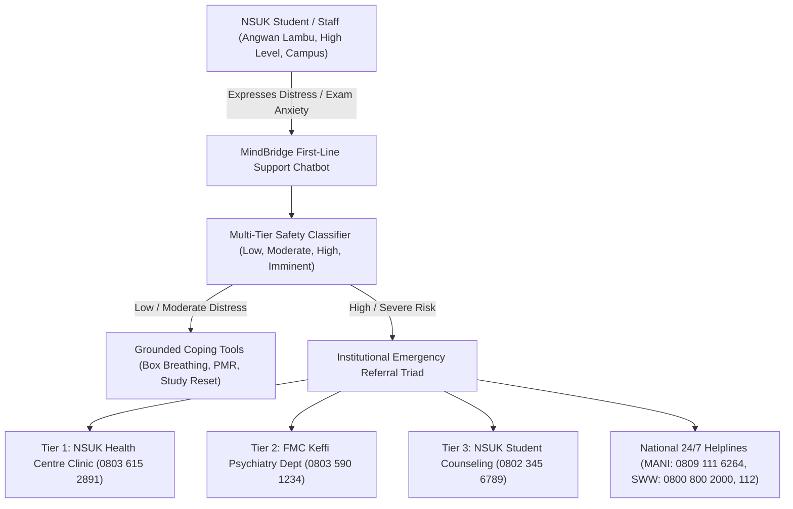

# MindBridge Chatbot 🤖🌉
> **"A mental health support chatbot that understands your context."**
> **Case Study: Nasarawa State University, Keffi (NSUK)**

MindBridge is an AI-powered, culturally adapted first-line mental health **support chatbot** built primarily for users in **Nigeria and the broader African context**, adapted as a dedicated institutional case study for **Nasarawa State University, Keffi (NSUK)**.

Users sign in and chat with MindBridge, in English or Nigerian Pidgin. Every message passes through a safety pipeline before and after the AI replies. The chatbot connects the real lived experiences of Nigerian university students and African youths — taking into account:
* **Academic Stress**: Continuous Assessment (CA) deadlines, semester exam anxieties, carry-over and spillover dread, clearance procedures, and strike backlogs.
* **Campus & Off-Campus Realities in Keffi**: Living in high-density student areas like **Angwan Lambu**, **High Level**, **Total Junction**, and Main Campus Hostels; contending with power blackouts, generator noise, and intense daytime heat.
* **Family & Communal Pressure**: Navigating extended family expectations, "black tax", and fear of disappointing home communities.
* **Linguistic Nuance**: Natural communication in English, **authentic Nigerian Pidgin**, and Keffi/Northern expressions ("sannu", "ba matsala", "hankuri").
* **Institutional Referral Triad**: Seamless bridges to **NSUK University Health Services** (Campus Clinic: `0803 615 2891`), **Federal Medical Centre (FMC) Keffi** (`0803 590 1234`), and **NSUK Guidance & Counseling Unit** (`0802 345 6789`).

---

## 🏛️ The NSUK Case Study Architecture



---

## ⚠️ Important Ethical, Safety & Medical Non-Diagnostic Boundaries

* **Not a Healthcare Provider**: MindBridge does NOT present itself as a doctor, clinical psychologist, psychiatrist, therapist, or emergency dispatch service.
* **Non-Diagnostic Policy**: MindBridge will **NEVER** claim to diagnose a mental health condition (e.g. depression, anxiety disorder, bipolar).
* **Zero Prescriptions**: MindBridge will **NEVER** prescribe medication or advise on pharmaceutical dosages.
* **Proactive Life Safety**: MindBridge incorporates a multi-tier safety classifier (Low, Moderate, High, Imminent) that intercepts suicidal thoughts, self-harm, or severe crises and immediately provides verified 24/7 Nigerian emergency hotlines.
* **Real, Audited Resources**: All healthcare centers and emergency crisis lines displayed on MindBridge are verified by administrators.

---

## 🌟 Chatbot Features

1. **Culturally Sensitive Conversational AI**
   - Google Gemini by default, plus any OpenAI-compatible provider (NVIDIA NIM, DeepSeek, Kimi, GLM, OpenAI).
   - Language switching mid-chat (English, Nigerian Pidgin, Yoruba, Hausa, Igbo context).
   - Personalised replies from the user's profile: faculty, level, residence, preferred tone, and (optionally) faith.
   - "Ask, rather than assume" principle: no stereotyping.
   - Offline fallback replies when no API key is configured, so the chatbot always answers.
2. **Safety Pipeline Around Every Message**
   - `User Message` ➔ `Input Validation` ➔ `Crisis Detection` ➔ `Context Enrichment` ➔ `AI Model` ➔ `Output Safety Validation` ➔ `Safe Response`.
   - High/Imminent risk messages skip the AI entirely and return verified NSUK, FMC Keffi and national crisis contacts.
   - Replies that diagnose, prescribe, or stereotype are blocked and replaced.
3. **Conversation Management**
   - Multiple chats with a sidebar, rename, delete, search, Markdown export, and "clear all".
   - Users can report any chatbot reply; reported messages become visible to admins for review.
4. **Crisis Support Built Into the Chat UI**
   - Persistent 1-tap **"Need urgent help?"** modal and a `/crisis-support/` hub with verified hotlines.
5. **Privacy (NDPR & GDPR)**
   - Chat content is hidden from admins unless reported or safety-flagged.
   - JSON data export and full account deletion under Settings.

> The codebase also contains supporting modules (mood check-ins, PHQ/GAD self-assessments, coping toolkit, professionals directory). They are no longer linked from the main navigation, which now centres on the chatbot, but their URLs still work.

---

## 🛠️ Technology Stack

* **Backend**: Python 3.12+, Django 5/6, Django REST Framework.
* **Database**: PostgreSQL (with automatic zero-config SQLite fallback for local development).
* **Frontend**: Django Templates, Bootstrap 5, Bootstrap Icons, Google Fonts (`Outfit` & `Plus Jakarta Sans`), Vanilla JavaScript / AJAX.
* **AI Abstraction Layer**: REST client supporting OpenAI-compatible APIs (NVIDIA NIM, DeepSeek, Kimi, GLM, OpenAI).
* **Security & Auditing**: CSRF protection, secure cookies, security headers, rate limiting, and structured audit logs.

---

## ⚡ One-Click Run on Any PC

You can launch MindBridge on **any computer** with a single command or double-click — the runner will automatically create a virtual environment, install dependencies, prepare the database, and launch your browser:

### 🪟 Windows:
* **Option A (Double-Click)**: Simply double-click **`run.bat`** in File Explorer.
* **Option B (Terminal)**:
  ```cmd
  run.bat
  ```

### 🍎 macOS & 🐧 Linux:
* Run the shell script:
  ```bash
  chmod +x run.sh
  ./run.sh
  ```

### 🐍 Cross-Platform (Any Operating System):
* Run with Python directly:
  ```bash
  python run.py
  ```

---

## 🚀 Deploy to Vercel

This project is pre-configured for Vercel's zero-configuration Django support
(`manage.py` is auto-detected, static files are collected and served from the
Vercel CDN).

> **Why PostgreSQL?** Vercel Functions have a read-only, ephemeral filesystem, so
> the local SQLite database cannot be used in production. A free PostgreSQL
> database (Neon, Supabase, etc.) is required.

1. **Import the repo** at [vercel.com/new](https://vercel.com/new) →

   `https://github.com/Haditech2/queen`

2. **Add a PostgreSQL database.** In the Vercel project go to **Storage →
   Create Database → Neon** (or connect Supabase). Vercel injects
   `DATABASE_URL` automatically.

3. **Add environment variables** (Project → Settings → Environment Variables):

   | Variable | Value |
   | --- | --- |
   | `SECRET_KEY` | a long random string (generate: `python -c "import secrets;print(secrets.token_urlsafe(50))"`) |
   | `DEBUG` | `False` |
   | `ADMIN_PASSWORD` | password for the `admin@mindbridge.africa` superuser |
   | `AI_API_KEY` | your Gemini / NVIDIA / DeepSeek / OpenAI key |
   | `AI_PROVIDER` | `gemini` (or `nvidia`, `deepseek`, `kimi`, `glm`, `openai`) |
   | `AI_MODEL` | the model name for that provider |
   | `AI_BASE_URL` | the provider's OpenAI-compatible base URL |

   Optional: `ALLOWED_HOSTS` and `CSRF_TRUSTED_ORIGINS` (comma-separated) when
   using a custom domain.

4. **Deploy.** `build.py` runs `migrate` and `seed_data` during the build
   (safely skipped if `DATABASE_URL` is not a PostgreSQL URL yet). Vercel runs
   `collectstatic` for you.

5. **After the first deploy**, open `https://<your-app>.vercel.app/` and sign in
   to `/admin/` with the seeded account (`admin@mindbridge.africa` and the
   `ADMIN_PASSWORD` you set). If you deployed without `ADMIN_PASSWORD`, the
   account is created with an unusable password and cannot be logged into —
   set `ADMIN_PASSWORD` and redeploy to activate it.

Redeploy after changing environment variables so the new values take effect.

---

## 🛠️ Manual Installation & Setup (Step-by-Step)

### 1. Clone & Enter Directory
```bash
cd QUEEN
```

### 2. Set Up Virtual Environment
```bash
python -m venv venv
# On Windows:
venv\Scripts\activate
# On Linux/macOS:
source venv/bin/activate
```

### 3. Install Dependencies
```bash
pip install -r requirements.txt
```

### 4. Configure Environment Variables
Copy `.env.example` to `.env`:
```bash
cp .env.example .env
```

Edit `.env` with your settings:
```env
SECRET_KEY=your-secure-secret-key-here
DEBUG=True
ALLOWED_HOSTS=localhost,127.0.0.1,[::1]

# Database (PostgreSQL URL or SQLite)
DATABASE_URL=sqlite:///mindbridge.sqlite3

# AI Configuration (OpenAI-compatible)
AI_PROVIDER=nvidia
AI_MODEL=deepseek-ai/deepseek-v4.1-flash
AI_BASE_URL=https://integrate.api.nvidia.com/v1
AI_API_KEY=your-api-key-here
```

*(Note: If `AI_API_KEY` is not provided, MindBridge automatically operates in an intelligent, culturally adapted offline fallback mode for testing and demonstration).*

### 5. Apply Database Migrations
```bash
python manage.py makemigrations
python manage.py migrate
```

### 6. Seed Verified Data and Default Admin
Populate the database with verified Nigerian crisis hotlines, verified mental health teaching hospitals, accredited clinics, safety rules, coping tools, and clinical screening questionnaires:
```bash
python manage.py seed_data
```

This creates a default administrative account:
* **Email**: `admin@mindbridge.africa`
* **Password**: `AdminPassword2026!`

### 7. Run the Development Server
```bash
python manage.py runserver
```
Visit **`http://127.0.0.1:8000/`** in your browser.

---

## 🤖 AI Provider Configurations

MindBridge includes a pluggable AI abstraction layer (`apps.chatbot.ai_client.LLMClient`). You can switch providers simply by changing `.env`:

### Google Gemini API (Recommended)
MindBridge supports Google Gemini models via both the official OpenAI-compatible gateway and direct REST API:
```env
AI_PROVIDER=gemini
AI_MODEL=gemini-3.6-flash
AI_BASE_URL=https://generativelanguage.googleapis.com/v1beta/openai
AI_API_KEY=AIzaSy...your-gemini-key
# Or use: GEMINI_API_KEY=AIzaSy...your-gemini-key
```
*(Compatible models: `gemini-1.5-flash`, `gemini-1.5-pro`, `gemini-2.0-flash`)*

### NVIDIA API (NIM)
```env
AI_PROVIDER=nvidia
AI_MODEL=deepseek-ai/deepseek-v4.1-flash
AI_BASE_URL=https://integrate.api.nvidia.com/v1
AI_API_KEY=nvapi-...
```

### DeepSeek Direct
```env
AI_PROVIDER=deepseek
AI_MODEL=deepseek-chat
AI_BASE_URL=https://api.deepseek.com/v1
AI_API_KEY=sk-...
```

### Kimi (Moonshot AI)
```env
AI_PROVIDER=kimi
AI_MODEL=moonshot-v1-8k
AI_BASE_URL=https://api.moonshot.cn/v1
AI_API_KEY=sk-...
```

### GLM (Zhipu AI)
```env
AI_PROVIDER=glm
AI_MODEL=glm-4
AI_BASE_URL=https://open.bigmodel.cn/api/paas/v4
AI_API_KEY=your-key
```

### OpenAI
```env
AI_PROVIDER=openai
AI_MODEL=gpt-4o-mini
AI_BASE_URL=https://api.openai.com/v1
AI_API_KEY=sk-...
```

---

## 🔒 Security & Privacy Architecture

1. **Rate Limiting**: Configured via Django REST Framework throttles (`60/min` anonymous, `120/min` user, `30/min` chat).
2. **Audit Logging**: All authentication and data events (logins, registrations, password changes, exports, safety crisis triggers) are recorded in `AuditLog` without exposing private chat content.
3. **Admin Privacy Safeguards**: In Django Admin, conversation texts are protected from administrative casual reading unless flagged for an active safety event or explicitly reported by the user.
4. **Security Headers**: Custom middleware enforces `X-Content-Type-Options: nosniff`, `X-Frame-Options: DENY`, `Referrer-Policy: strict-origin-when-cross-origin`, and `Permissions-Policy`.

---

## 🧪 Running Automated Tests

Run the full automated test suite (authentication, chat API, adversarial AI safety, crisis classifier, and supporting modules). Tests never call the live AI provider:

```bash
python manage.py test tests
```

---

## 🌍 URL Sitemap

* `/` — Chatbot landing page (signed-in users are sent straight to `/chat/`)
* `/register/` · `/login/` · `/logout/` — Accounts (login and registration open the chat)
* `/chat/` — **The chatbot**
* `/chat/new/` — Start a new chat
* `/conversations/` — Chat history & search
* `/api/chat/` — Chat REST endpoint (POST `{message, conversation_id, language}`; rate-limited to 30/min)
* `/crisis-support/` — 24/7 crisis helpline hub
* `/profile/` — Chatbot personalisation (language, tone, campus context)
* `/settings/` — Security, data export & deletion
* `/about/` · `/privacy/` · `/terms/` — Information pages
* `/admin/` — Administration portal
